<div align="center">

# 🛒💊 SmartPharma Cart

**Carrito mecatrónico que lee el lote y la fecha de vencimiento de cada caja de medicamento y la clasifica físicamente según el criterio FEFO.**

*Proyecto de Diseño Mecatrónico · Ingeniería en Mecatrónica · Universidad Militar Nueva Granada (UMNG) · Semestre IX · 2026*


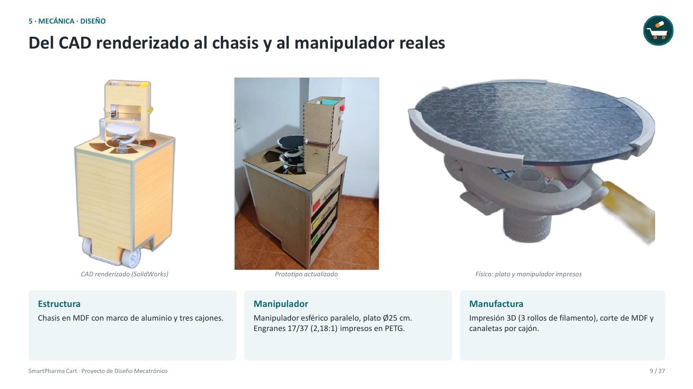

<sub>Del CAD en SolidWorks (izquierda) al prototipo construido (centro) y al plato con su manipulador esférico paralelo impreso en 3D (derecha).</sub>

[📘 Manual técnico](docs/manual/Manual_Tecnico_SmartPharma_Cart_v1.pdf) ·
[🎞️ Presentación final](docs/presentacion/SmartPharma_Cart_Presentacion_final.pdf) ·
[📰 Flyer](docs/presentacion/SmartPharma_Cart_Flyer_triptico.pdf) ·
[🎥 Videos](#-videos-del-proyecto) ·
[🧪 Informes FEM](docs/fem/)

</div>

---

## 📑 Contenido

1. [El problema](#-el-problema)
2. [Qué hace SmartPharma Cart](#-qué-hace-smartpharma-cart)
3. [Arquitectura del sistema](#-arquitectura-del-sistema)
4. [El prototipo](#-el-prototipo)
5. [Panel del regente (interfaz)](#-panel-del-regente-interfaz)
6. [Simulador del manipulador esférico paralelo (SPM)](#-simulador-del-manipulador-esférico-paralelo-spm)
7. [Visión artificial e IA](#-visión-artificial-e-ia)
8. [Electrónica y PCB](#-electrónica-y-pcb)
9. [Análisis de elementos finitos (FEM)](#-análisis-de-elementos-finitos-fem)
10. [Pruebas del prototipo](#-pruebas-del-prototipo)
11. [Videos del proyecto](#-videos-del-proyecto)
12. [Documentación](#-documentación)
13. [Estructura del repositorio](#-estructura-del-repositorio)
14. [Equipo](#-equipo)
15. [Para desarrollar en este repositorio](#-para-desarrollar-en-este-repositorio)

---

## 🎯 El problema

Revisar fechas de vencimiento en una droguería consume horas y falla con los empaques brillantes o troquelados. La encuesta del proyecto (34 personas entre regentes, auxiliares, droguerías y usuarios) mostró que:

| | |
|---|---|
| **67,6 %** | dedica más de 15 horas al mes a revisar vencimientos |
| **85,3 %** | tiene dificultad para leer fechas en cajas brillantes o troqueladas |
| **73,5 %** | prefiere comprar el equipo en lugar de rentarlo |

**Objetivo del proyecto:** desarrollar un carrito mecatrónico automatizado que clasifique cajas de medicamentos de 10 a 30 g, con lote y fecha impresos en tinta, en tres rangos de vencimiento según FEFO, mediante visión artificial, y que derive a **revisión manual** las cajas sin lote o fecha legibles.

> **FEFO** (*First Expired, First Out*): sale primero lo que vence primero. Por eso el carrito separa las cajas según cuánto les falta para vencer.

---

## ⚙️ Qué hace SmartPharma Cart

El regente deja las cajas en el dispensador y arranca el recorrido desde el panel. Cada caja recorre seis pasos:

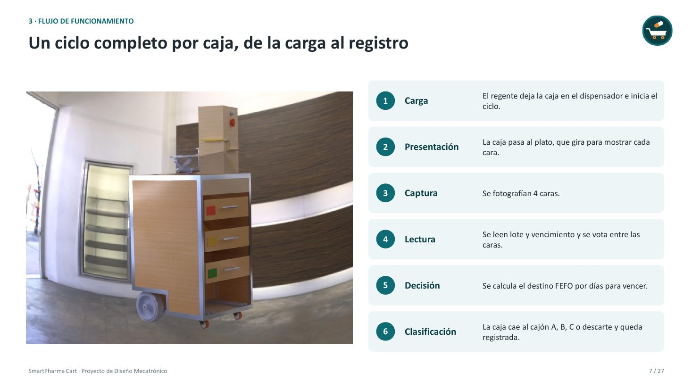

1. **Carga:** el regente deja la caja en el dispensador y da la orden de inicio.
2. **Presentación:** el dispensador empuja la caja al plato de clasificación.
3. **Captura:** el plato (manipulador esférico paralelo) la gira y la cámara fotografía cada cara.
4. **Lectura:** el módulo de visión detecta la zona de lote/fecha, aplica OCR y vota entre las caras.
5. **Decisión:** el sistema calcula el destino FEFO.
6. **Clasificación:** el plato se inclina y la caja cae al cajón correspondiente; el evento queda registrado.

| Destino | Cajón | Criterio |
|---|---|---|
| `TIPO_A` | 🔴 Rojo | Vencimiento más próximo: 90 días o menos |
| `TIPO_B` | 🟡 Amarillo | Vencimiento intermedio: de 91 a 180 días |
| `TIPO_C` | ⚪ Blanco | Vencimiento lejano: más de 180 días |
| `DESCARTE` | — | Lote o fecha sin leer, o decisión del regente: el plato se detiene y la persona procesa la caja a mano |

> Los rangos de días son configurables: se cambian en el módulo de reconocimiento, no en el firmware.

---

## 🧠 Arquitectura del sistema

Cuatro niveles, con un principio central: **flujo de control estrictamente secuencial**. Ningún nodo avanza al siguiente objeto sin una confirmación explícita del actual, lo que elimina condiciones de carrera sin locks ni IDs de correlación.

```
ESP32-S3  <--UART-->  Orange Pi Zero 2W  <--TCP/mDNS-->  PC  <--Panel web-->  Regente de farmacia
(control físico        (gateway: cámara,                 (servidor, IA,
 en tiempo real)        giros y red)                      inventario y registro)
```

| Subsistema | Hardware principal | Función |
|---|---|---|
| **Chasis y tracción** | Tubular de aluminio 20×20, paredes de MDF, 2 ruedas traseras de 6 in con motores 210:1 y 2 rodachinas | Soportar todo y desplazar el carrito |
| **Gabinetes** | 3 cajones con rieles de extensión y toboganes impresos | Recibir las cajas clasificadas |
| **Dispensador** | Motor 12 V con encoder, piñón de 14 dientes y cremallera de 263 mm, ESP32-S3 SuperMini + TB6612FNG | Entregar una caja a la vez al plato |
| **Plato SPM** | Manipulador esférico paralelo, 3 motorreductores JGA25-370, engranes 17/37 en PETG, 2 drivers DRV8833 | Girar la caja y volcarla hacia el cajón |
| **Visión** | Cámara Arducam USB HDR 1080p, soporte impreso, detector YOLOv8n + OCR | Fotografiar las caras y leer lote y vencimiento |
| **Control y comunicación** | ESP32-S3 N16R8 en PCB propia, Orange Pi Zero 2W, PC | Ejecutar el ciclo y registrar cada evento |
| **Energía** | Batería de plomo-ácido sellada 12 V / 12 Ah, 3 reguladores XL4015 (10 V, 5 V, 3,3 V) | Alimentar electrónica y motores |

**Comunicaciones:** UART a 115 200 baudios con suma de verificación XOR (ESP32-S3 ↔ Orange Pi), TCP 5000/5001 con descubrimiento mDNS (Orange Pi ↔ PC) y panel HTTP en el puerto 8080. El contrato de mensajes vive en [`shared/`](shared/) y está documentado en [`docs/arquitectura_comunicacion.md`](docs/arquitectura_comunicacion.md).

---

## 🏗️ El prototipo

<table>
<tr>
<td width="50%">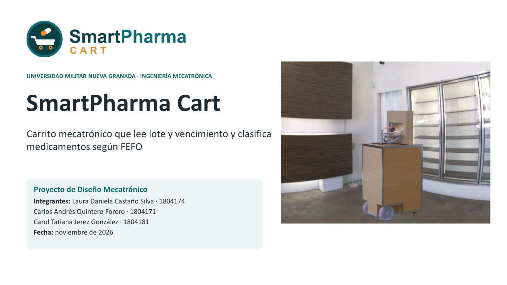</td>
<td width="50%">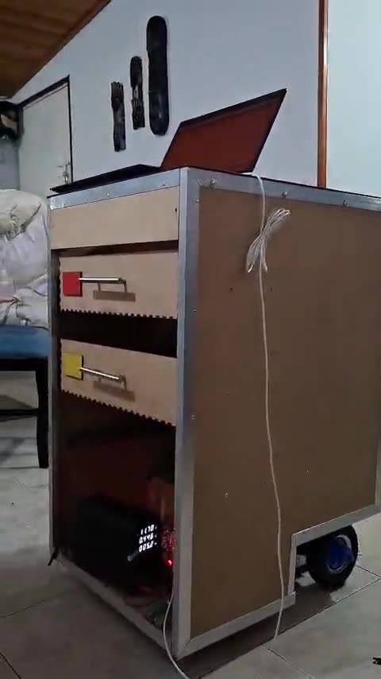</td>
</tr>
<tr>
<td align="center"><sub>SmartPharma Cart — presentación final</sub></td>
<td align="center"><sub>Prototipo durante las pruebas de la base de tracción</sub></td>
</tr>
</table>

| Parámetro | Valor |
|---|---|
| Dimensiones del chasis | 500 mm de ancho × 600 mm de fondo × 844 mm de alto |
| Masa del chasis | ≈ 18 kg |
| Plato de clasificación | Manipulador esférico paralelo de 3 motores; disco de acrílico Ø 250 mm × 4 mm |
| Carga sobre el plato | 2,8 kg soportados (la meta era 2 kg); cajas de prueba de 10 a 30 g |
| Cámara | Arducam USB HDR, 1080p a 30 fps; operada a 3264 × 2448 con enfoque manual fijo |
| Motores del plato | 3 × JGA25-370, 60 rpm a 12 V (alimentados a 10 V), reducción 103:1 |
| Motores de tracción | 2 × CQRobot Ocean 12 V, 6 W, 52 rpm, reducción 210:1 con encoder |
| Velocidad del carro | 0,16 m/s máx. del chasis, aceleración 0,25 m/s² |
| Costo de materiales | $ 2.025.834 COP (BOM efectivo) |

Todo el detalle —despiece, lista de materiales, explosionado, planos y mantenimiento— está en el [**Manual técnico**](docs/manual/Manual_Tecnico_SmartPharma_Cart_v1.pdf) (72 páginas).

---

## 🖥️ Panel del regente (interfaz)

El regente opera el carrito desde un **panel web** servido por la PC. Mirar el panel y el registro es libre; **operar** (iniciar o detener el recorrido, resolver alertas, editar el inventario) exige un turno abierto, y cada acción queda a nombre de la persona que la hizo.

<table>
<tr>
<td width="50%">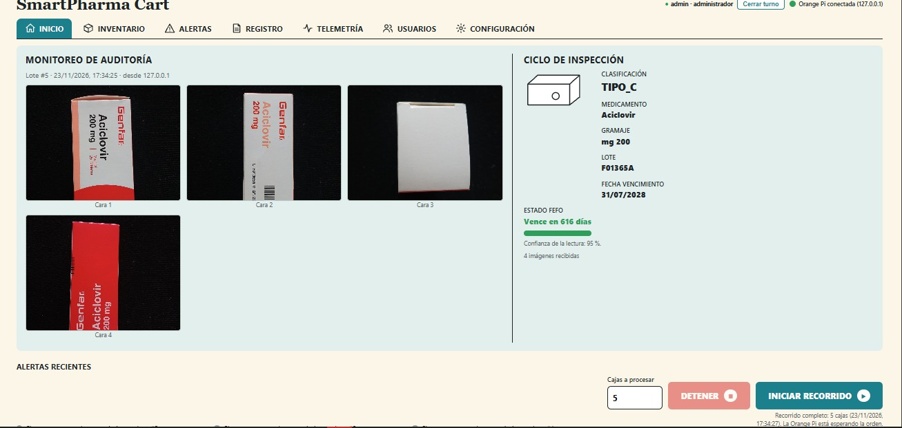</td>
<td width="50%">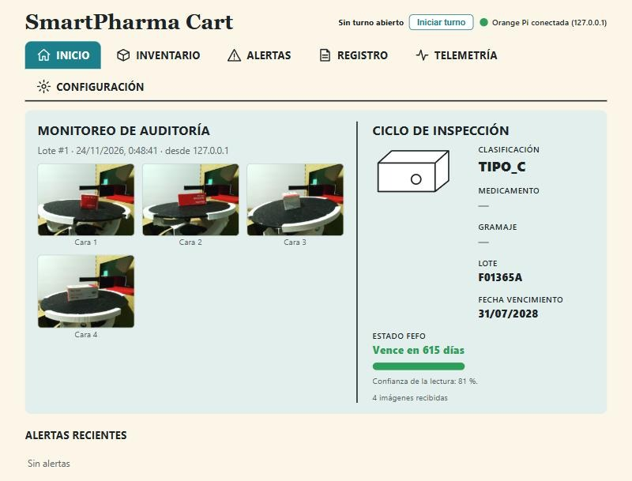</td>
</tr>
<tr>
<td align="center"><b>Inicio</b> — fotos de cada cara, lectura de la IA, estado FEFO y botones <i>Iniciar recorrido</i>, <i>Detener</i> y <i>Llevar a punto</i></td>
<td align="center"><b>Prueba con el plato y la cámara reales</b> — la caja se fotografía sobre el plato SPM</td>
</tr>
<tr>
<td width="50%">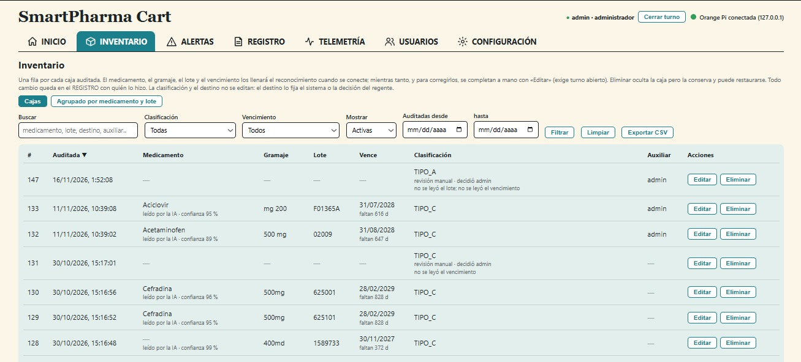</td>
<td width="50%">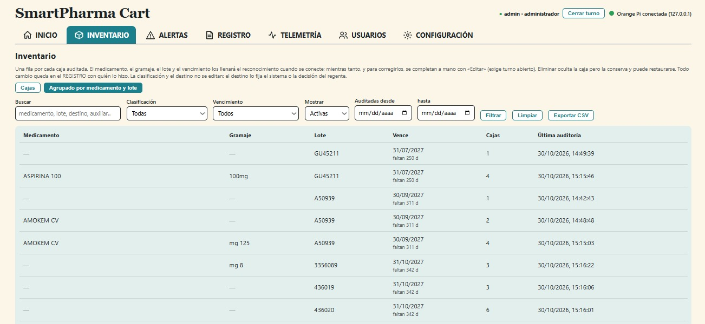</td>
</tr>
<tr>
<td align="center"><b>Inventario</b> — una fila por caja, con filtros, edición y exportación a CSV</td>
<td align="center"><b>Vista agrupada</b> por medicamento y lote</td>
</tr>
<tr>
<td width="50%">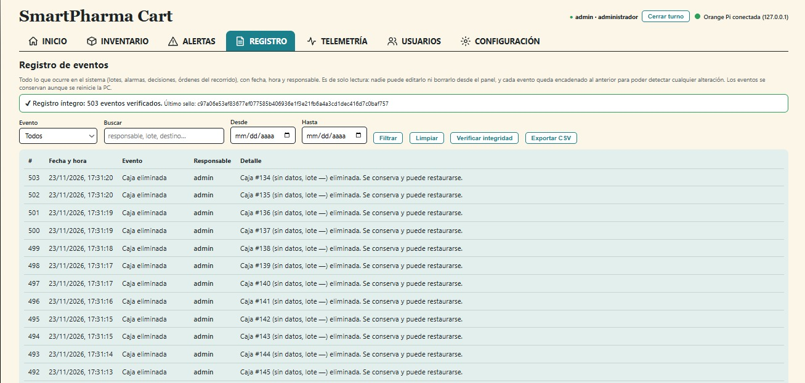</td>
<td width="50%">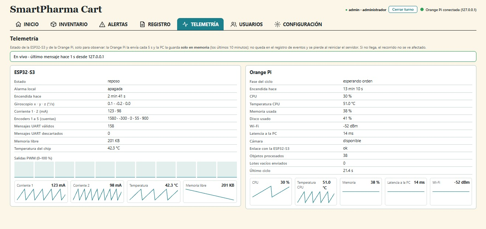</td>
</tr>
<tr>
<td align="center"><b>Registro</b> — solo lectura y encadenado por hashes para detectar cualquier alteración</td>
<td align="center"><b>Telemetría</b> — estado de la ESP32-S3 y de la Orange Pi en vivo</td>
</tr>
<tr>
<td width="50%">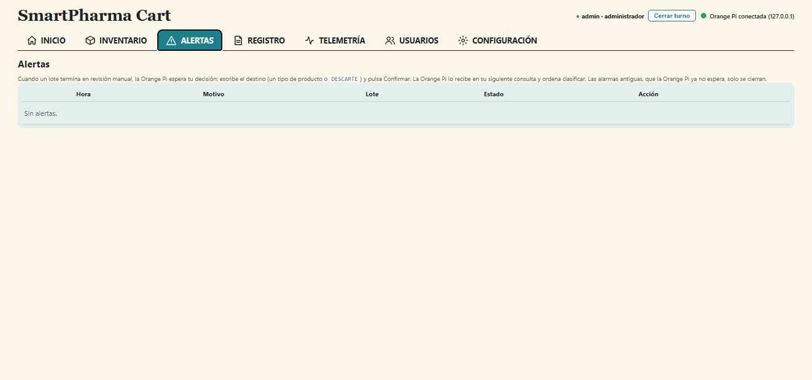</td>
<td width="50%">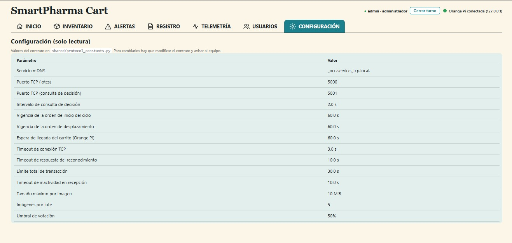</td>
</tr>
<tr>
<td align="center"><b>Alertas</b> — el regente decide el destino de las cajas que el sistema no pudo leer</td>
<td align="center"><b>Configuración</b> — parámetros del contrato (solo lectura)</td>
</tr>
</table>

<details>
<summary>Más capturas: inicio y edición de una caja</summary>

<table>
<tr>
<td width="50%">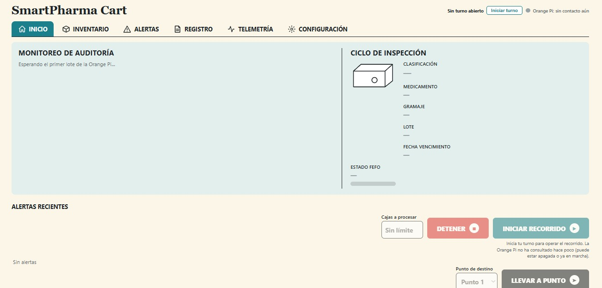</td>
<td width="50%">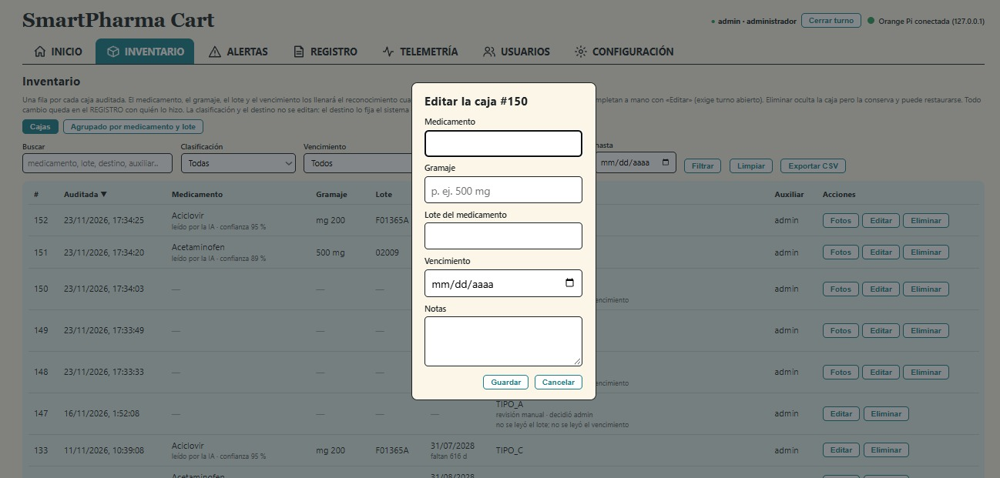</td>
</tr>
<tr>
<td align="center">Inicio, antes de abrir turno</td>
<td align="center">Edición manual de medicamento, gramaje, lote, vencimiento y notas (queda en el registro con el antes y el después)</td>
</tr>
</table>

</details>

Guía de uso completa: [`docs/GUIA_REGENTE.md`](docs/GUIA_REGENTE.md). Código del panel: [`pc/`](pc/).

---

## 🦾 Simulador del manipulador esférico paralelo (SPM)

Antes de mover el hardware, el plato se diseña y se prueba en un **simulador propio** ([`esp32-firmware/simulador_spm/`](esp32-firmware/simulador_spm/)). Permite calcular la orientación del plato (cinemática directa e inversa), ver el mecanismo del CAD en 3D con su **mapa de colisiones**, planificar trayectorias, simular el seguimiento con motor y encoder simulados y conectarse por serial a la ESP32-S3 para mover los motores reales y ver su telemetría reflejada en el modelo 3D.

<table>
<tr>
<td width="50%">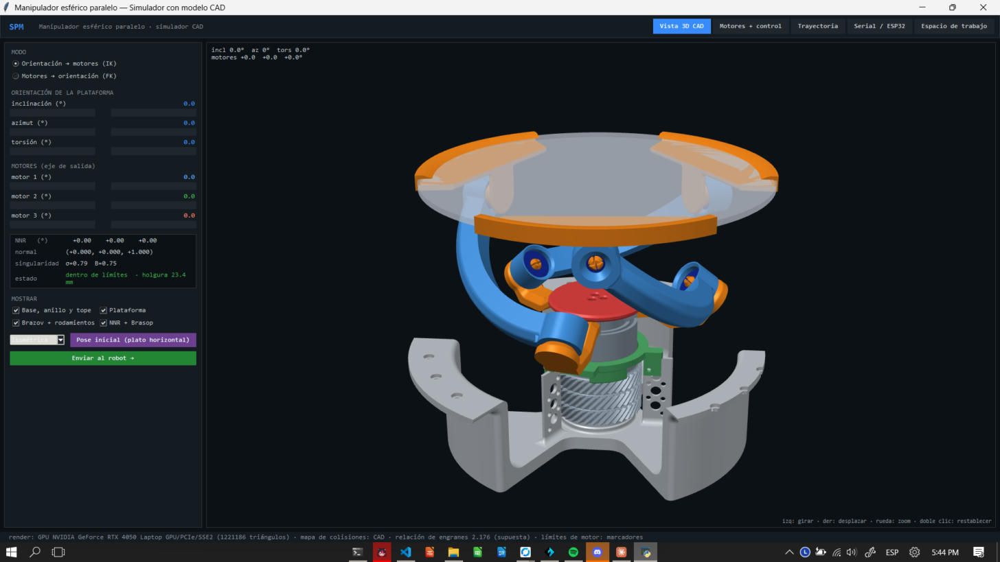</td>
<td width="50%">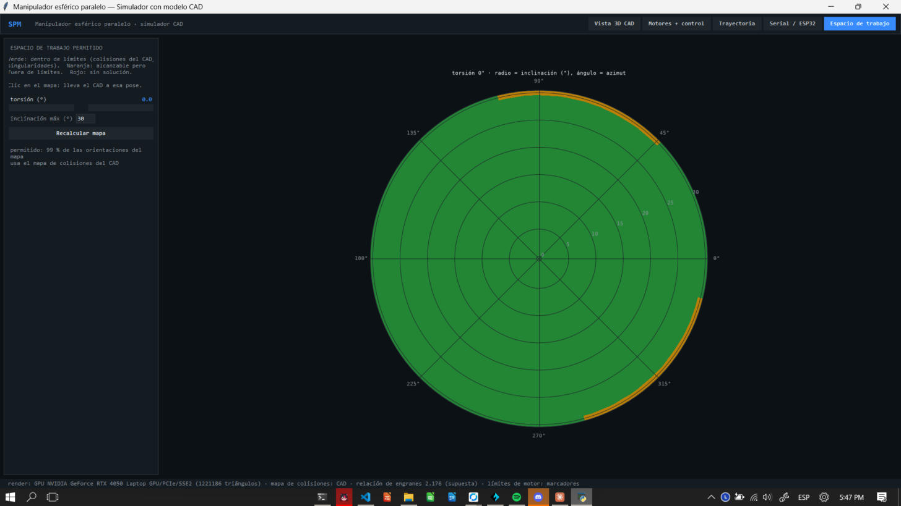</td>
</tr>
<tr>
<td align="center"><b>Vista 3D del CAD</b> con render por GPU</td>
<td align="center"><b>Espacio de trabajo</b> y zonas de colisión</td>
</tr>
<tr>
<td width="50%">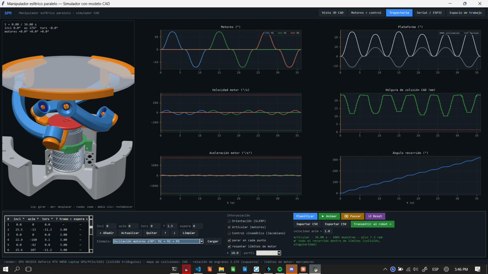</td>
<td width="50%">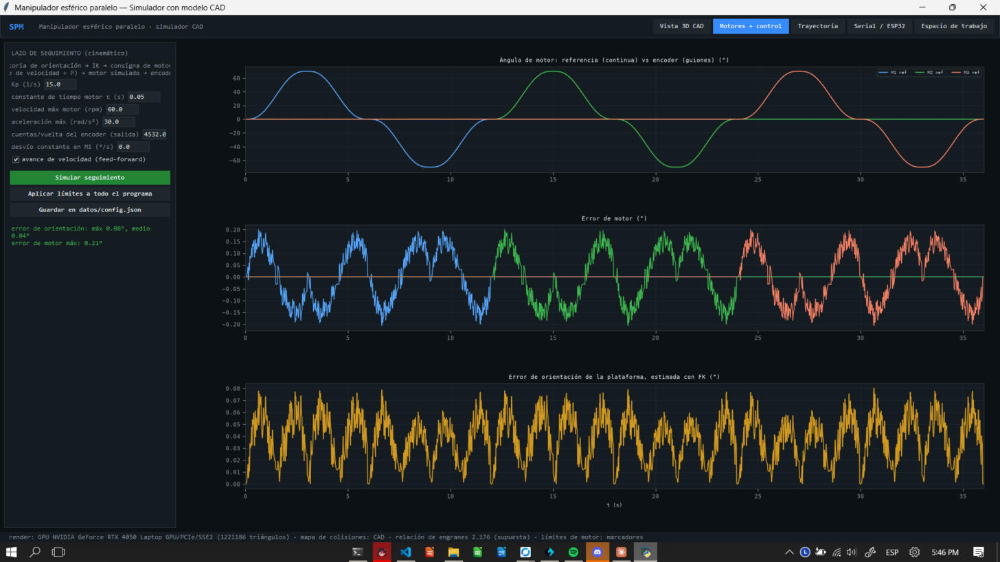</td>
</tr>
<tr>
<td align="center"><b>Trayectorias</b> (SLERP, interpolación articular o jacobiana, perfil quíntico o trapezoidal)</td>
<td align="center"><b>Motores y control</b> con los modelos identificados sobre el motor real</td>
</tr>
</table>

<p align="center">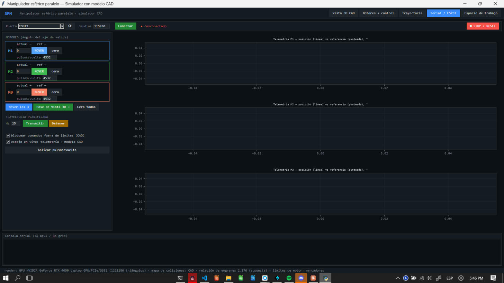<br><sub><b>Serial</b>: conexión con la ESP32-S3 real y telemetría reflejada en el modelo 3D</sub></p>

Incluye también el firmware de la ESP32-S3 con control en cascada sobre DRV8833, las ganancias identificadas (`identificacion_drv8833_pwm09/`), las trayectorias SmartPharma (cámara, clasificación y descarte) y pruebas automatizadas. Ver [`DESCRIPCION_SIMULADOR.md`](esp32-firmware/simulador_spm/docs_simulador/DESCRIPCION_SIMULADOR.md) y el [registro de cambios](esp32-firmware/simulador_spm/CAMBIOS_2026-11-06_a_09.md).

---

## 👁️ Visión artificial e IA

La cámara fotografía 4 caras por caja (opcionalmente 5). Cada foto pasa por un detector **YOLOv8n** que localiza la zona de lote y fecha, un **OCR** que la lee y una **votación entre caras** que decide el resultado.

<p align="center">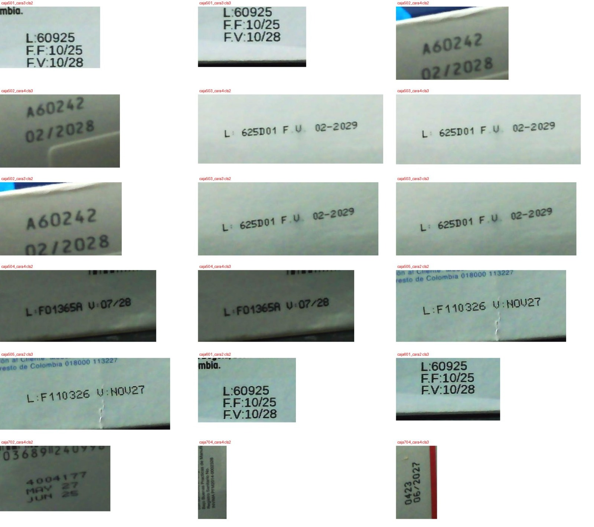<br><sub>Recortes de lote y vencimiento tomados con la cámara Arducam</sub></p>

El código de la IA está en [`IA/`](IA/) y se ejecuta dentro del proceso de la PC. Cuando el lote o la fecha no se pueden leer, la caja **no se adivina**: va a revisión manual y el regente decide.

---

## 🔌 Electrónica y PCB

Diseño en **KiCad** de la PCB de control (ESP32-S3 N16R8) y la de potencia, con esquema eléctrico, archivos Gerber y modelo STEP, en cinco iteraciones (`PCBBy2` a `PCBBy4_cont`).

- 📁 [`hardware/pcb-electronica/`](hardware/pcb-electronica/)
- 📄 [Esquema eléctrico](hardware/pcb-electronica/Esquema%20electrico.pdf) · [PCB de control](hardware/pcb-electronica/PCBB%20control.pdf) · [PCB de potencia](hardware/pcb-electronica/PCBB%20potencia.pdf)

Drivers: **DRV8833** (plato), **BTS7960** (base de tracción) y **TB6612FNG** (dispensador). Sensores: giroscopio MPU-6050, corriente ACS712 y ADC ADS111x por I2C. El mapa de pines de la ESP32-S3 está en el manual técnico (capítulo V).

---

## 🧪 Análisis de elementos finitos (FEM)

Se hizo un **FEM estático lineal** del carrito completo (CalculiX + Gmsh; peso propio y medicamentos en los cajones) para revisar la estructura de MDF y aluminio, con el SPM, el dispensador y el soporte de cámara sobre la placa superior.

<table>
<tr>
<td width="50%">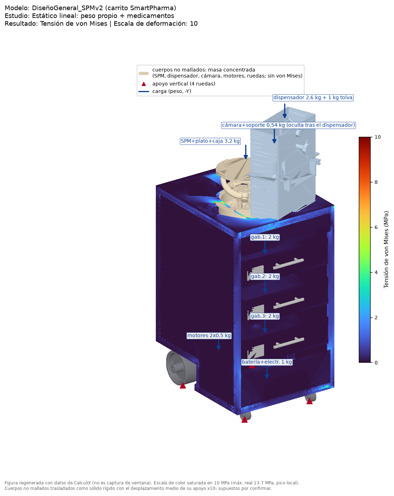</td>
<td width="50%">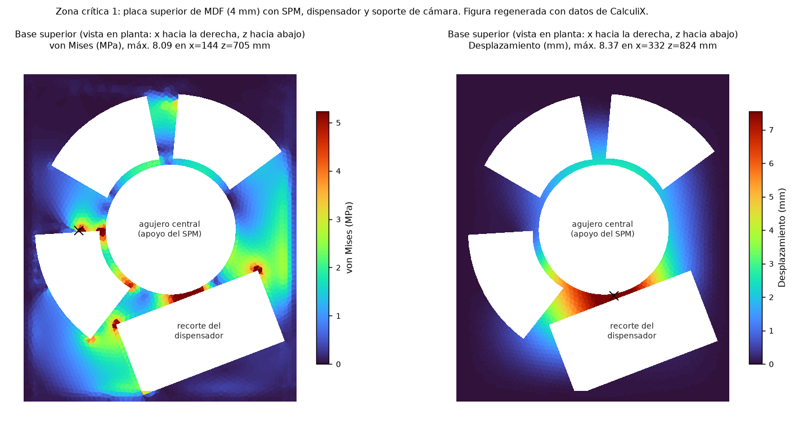</td>
</tr>
<tr>
<td align="center">Tensión de von Mises en el ensamblaje completo</td>
<td align="center">Placa superior: tensión y desplazamiento</td>
</tr>
<tr>
<td width="50%">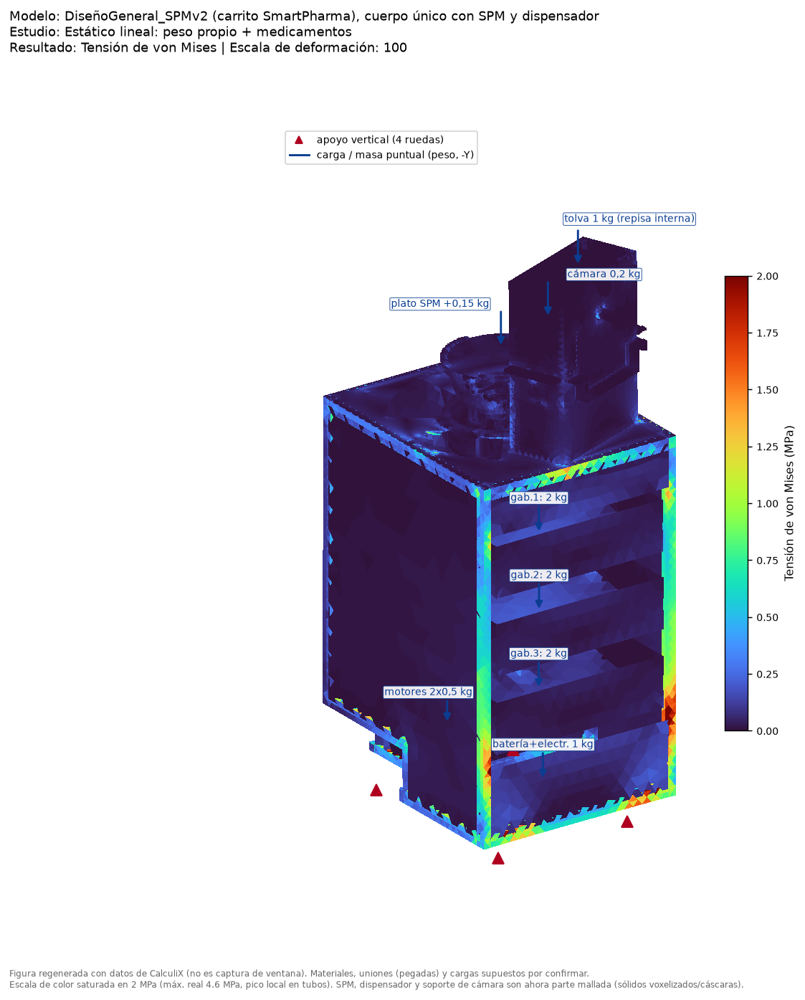</td>
<td width="50%">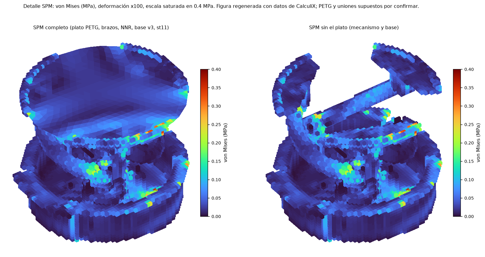</td>
</tr>
<tr>
<td align="center">Ensamblaje como cuerpo único, con el SPM y el dispensador mallados</td>
<td align="center">Detalle del SPM</td>
</tr>
</table>

Los informes con los supuestos, la verificación y el cálculo a mano están en [`docs/fem/`](docs/fem/). Las figuras de este README están en [`docs/media/fem/`](docs/media/fem/).

---
## ✅ Pruebas del prototipo

| Subsistema | Qué se comprobó |
|---|---|
| **Plato SPM** | 4 caras y 3 destinos con cajas de 30 g; 10 ciclos de las 4 caras con deriva ≤ 0,2°; ciclo de 30 a 32 s |
| **Dispensador** | 3 de 3 ciclos con cajas reales sin fallas; carrera de 75 mm en ~1,65 s, error máx. 0,18 mm, repetibilidad 0,02 mm |

Las pruebas se pueden ver en los [videos](#-videos-del-proyecto) y se detallan en el capítulo XI del [manual técnico](docs/manual/Manual_Tecnico_SmartPharma_Cart_v1.pdf).

---
## 🎥 Videos del proyecto

<div align="center">

<video src="https://raw.githubusercontent.com/Arlo-qexe/smartpharma-cart/main/docs/media/videos/00_proceso_diseno_manufactura_integracion.mp4" controls width="720"></video>

**Proceso de diseño, manufactura e integración mecatrónica** ([ver el video](docs/media/videos/00_proceso_diseno_manufactura_integracion.mp4))

</div>

| | | |
|:---:|:---:|:---:|
| [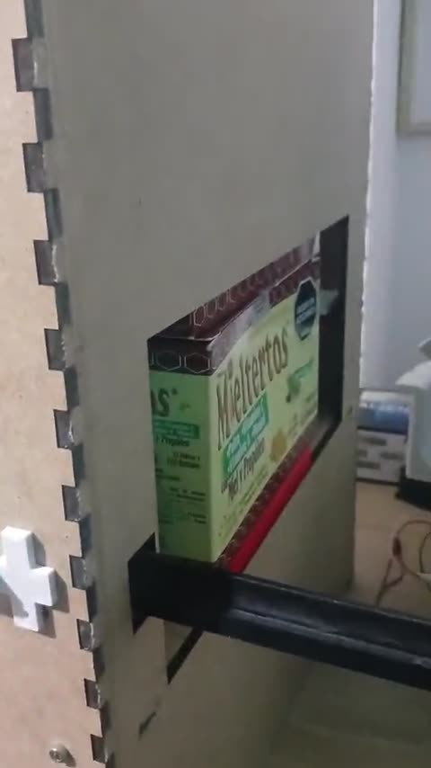](docs/media/videos/01_dispensador.mp4)<br>**Dispensador** | [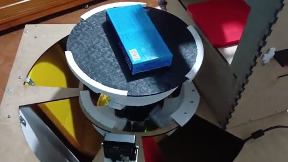](docs/media/videos/02_clasificacion_tipo_A.mp4)<br>**Clasificación a Tipo A** | [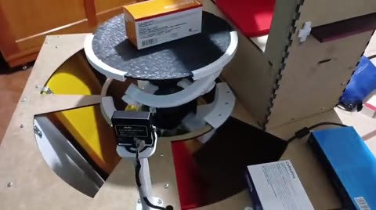](docs/media/videos/03_tres_ciclos_tobogan_amarillo.mp4)<br>**3 ciclos, tobogán amarillo** |
| [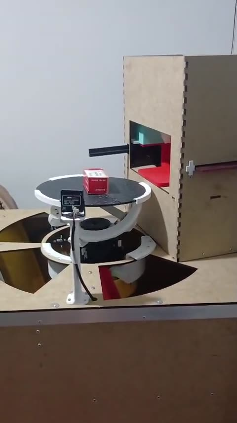](docs/media/videos/05_reconocimiento_camara_tipo_C.mp4)<br>**Lectura con cámara → Tipo C** (vence 07/28) | [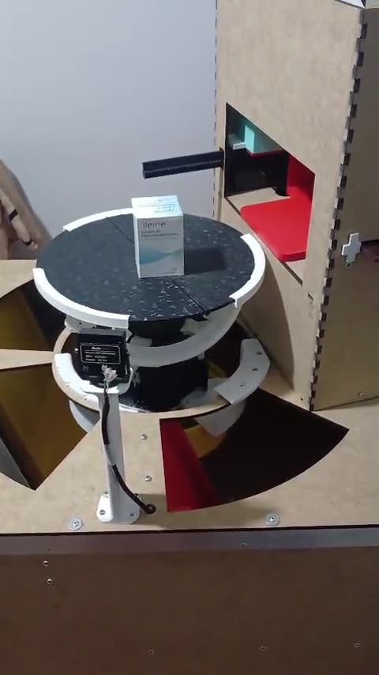](docs/media/videos/06_descarte_revision_manual.mp4)<br>**No leyó la fecha → descarte y revisión manual** | [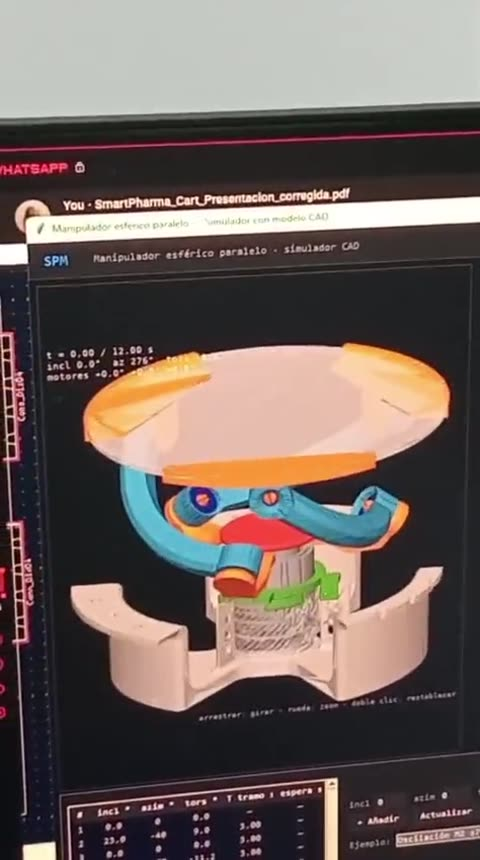](docs/media/videos/04_simulador_con_plato_fisico.mp4)<br>**Simulador con el plato físico** |
| [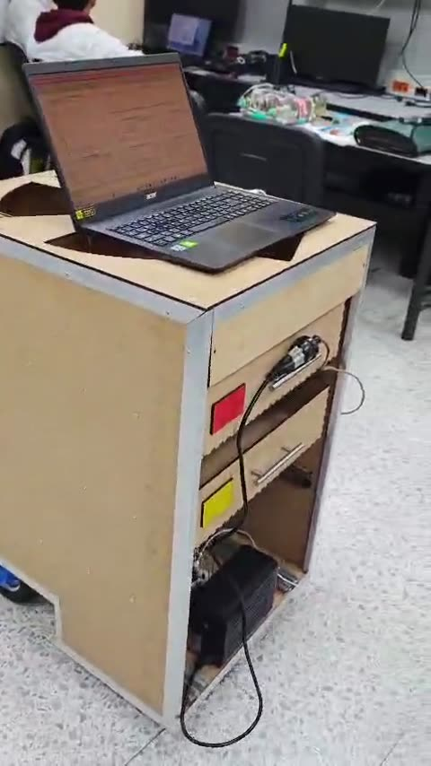](docs/media/videos/07_traccion.mp4)<br>**Sistema de tracción** | [](docs/media/videos/08_traccion_trayectoria_recta.mp4)<br>**Tracción: trayectoria recta** | |

---

## 📚 Documentación

| Documento | Contenido |
|---|---|
| [📘 Manual técnico (PDF, 72 págs.)](docs/manual/Manual_Tecnico_SmartPharma_Cart_v1.pdf) | Mecánica, despiece y BOM, sistema eléctrico, control y comunicaciones, operación, mantenimiento, diagnóstico de fallas, seguridad y pruebas |
| [🎞️ Presentación final (PDF, 27 diapositivas)](docs/presentacion/SmartPharma_Cart_Presentacion_final.pdf) | Requisitos, diseño, control, IA, comunicación y precio de venta |
| [📰 Flyer / tríptico](docs/presentacion/SmartPharma_Cart_Flyer_triptico.pdf) | Resumen comercial del proyecto |
| [🧪 Informes FEM](docs/fem/) | Análisis de elementos finitos del carrito, con supuestos y verificación |
| [📡 Arquitectura de comunicación](docs/arquitectura_comunicacion.md) | Protocolo completo ESP32-S3 ↔ Orange Pi ↔ PC ↔ regente |
| [📝 Changelog del protocolo](docs/CHANGELOG_protocolo.md) | Historial de cambios al contrato |
| [🧑‍⚕️ Guía del regente](docs/GUIA_REGENTE.md) | Uso del panel de control |
| [✅ Checklist PC ↔ Orange Pi](shared/checklist.md) | Estado compartido, solicitudes y decisiones entre los dos lados |
| [📊 Informe de avances](shared/INFORME_AVANCES_2026-11-03.md) | Avances de PC, Orange Pi, ESP32-S3 e IA al 2026-11-03 |

---

## 🗂️ Estructura del repositorio

```
smartpharma-cart/
├── docs/                      # arquitectura, guía del regente, manual, presentación y FEM
│   ├── manual/                # manual técnico (PDF)
│   ├── presentacion/          # presentación final y flyer (PDF)
│   ├── fem/                   # informes del análisis de elementos finitos
│   └── media/                 # imágenes y videos usados en este README
├── shared/                    # contrato de comunicación — fuente única de verdad
├── esp32-firmware/            # control físico en tiempo real (C++/Arduino)
│   └── simulador_spm/         # simulador del manipulador esférico paralelo + firmware del plato
├── orange-pi/                 # gateway de captura y red (Python)
├── pc/                        # servidor, panel del regente y asistente (Python)
├── IA/                        # lectura de lote y vencimiento (YOLOv8n + OCR)
├── hardware/
│   └── pcb-electronica/       # PCB de control y de potencia (KiCad)
├── tests/integration/         # pruebas de extremo a extremo
├── scripts/hooks/             # hooks de sincronización entre agentes
└── .github/workflows/         # aviso automático a Telegram cuando cambia shared/
```

---

## 👥 Equipo

**Grupo 3 — Diseño Mecatrónico, semestre IX** · Universidad Militar Nueva Granada · Ingeniería en Mecatrónica

- Laura Daniela Castaño Silva
- Carlos Andres Quintero Forero
- Carol Tatiana Jerez González

**Profesor:** Germán Leandro Vargas

---

## 🛠️ Para desarrollar en este repositorio

Este repo está organizado para que cada persona trabaje desde su propio dispositivo (Orange Pi o PC) sin perder sincronía con el otro lado, con agentes de Claude Code que se coordinan mediante el repositorio.

1. Configura el aviso de Telegram una sola vez: [`docs/TELEGRAM_SETUP.md`](docs/TELEGRAM_SETUP.md).
2. Lee [`CLAUDE.md`](CLAUDE.md) (raíz): resumen de la arquitectura, la regla de oro y cómo se sincronizan los agentes (hooks + Telegram).
3. Entra a la carpeta que te corresponde (`orange-pi/` o `pc/`) y lee su `CLAUDE.md`.
4. Corre Claude Code **desde esa subcarpeta** (`cd orange-pi && claude` o `cd pc && claude`) para que cargue el contexto general, el específico y los hooks de sincronización.

> **Regla de oro:** nunca escribas un nombre de mensaje, un timeout o un formato de datos directamente dentro de `orange-pi/`, `pc/` o `esp32-firmware/`. Todo cambio al contrato se hace primero en [`shared/`](shared/), se documenta en [`docs/CHANGELOG_protocolo.md`](docs/CHANGELOG_protocolo.md) y se avisa al equipo antes de hacer push.

Cada lado tiene su propio entorno virtual (`bash scripts/setup_venv.sh`): `orange-pi/` es ARM64 y `pc/` es x86_64 con CUDA, así que **nunca comparten un venv**.
