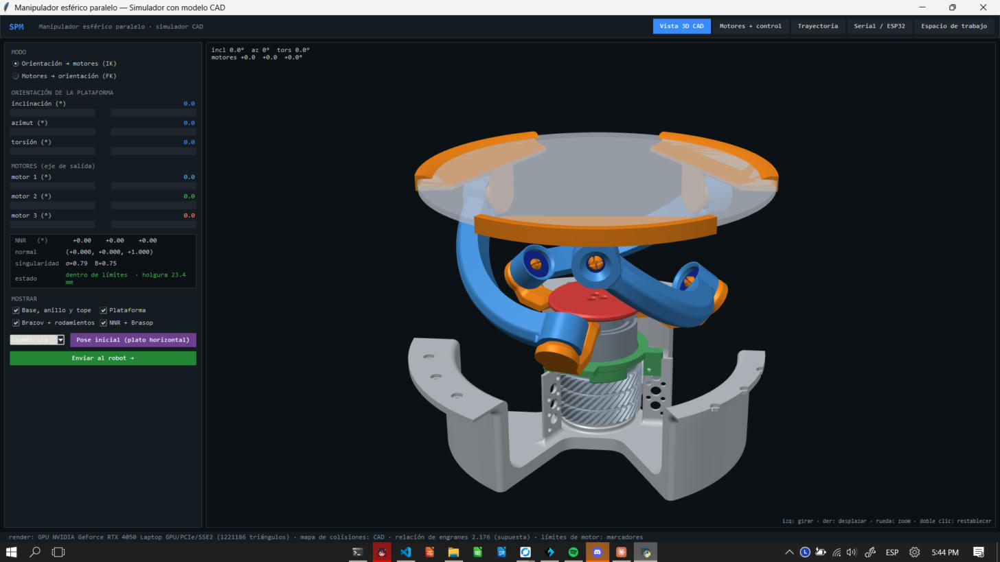
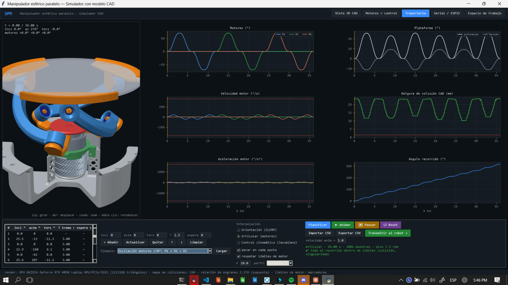
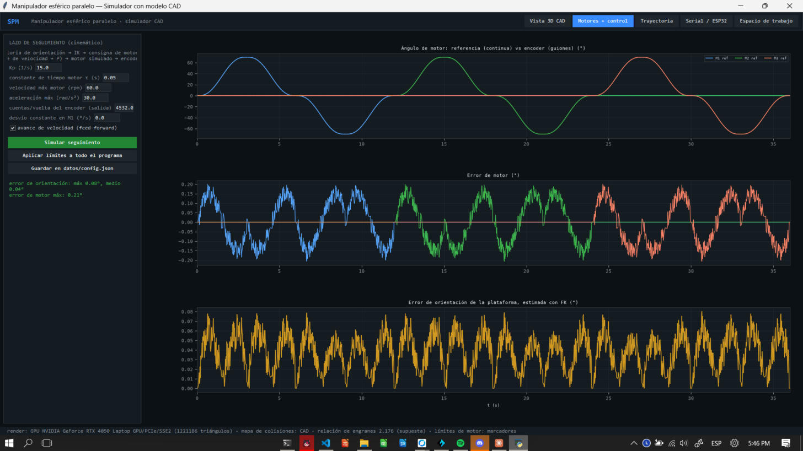
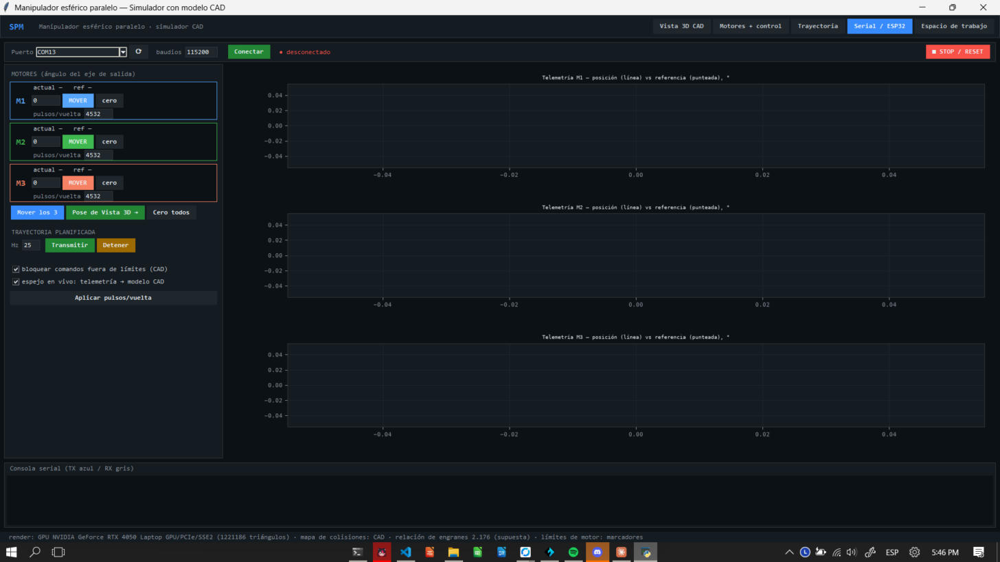
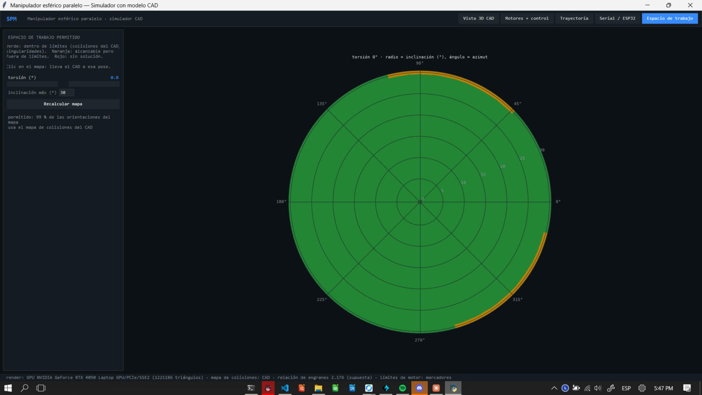

# Simulador del manipulador esférico paralelo (SPM)

Descripción breve del simulador `simulador_spm` del proyecto SmartPharma Cart, con capturas de la interfaz tomadas el 2026-11-10 en Windows
(Python 3.14, render por GPU). Las capturas están en `img/`.

## Para qué sirve

El SPM es el mecanismo de 3 patas que orienta el plato donde queda la caja de medicamento (se inclina y gira para presentar las 5 caras a la
cámara). El simulador permite, **antes de mover el hardware**:

- calcular la orientación del plato a partir de los 3 ángulos de motor (cinemática directa) y al revés (cinemática inversa);
- ver el mecanismo del CAD moviéndose en 3D y saber si una pose o trayectoria choca (mapa de colisiones calculado desde el CAD);
- planificar trayectorias (puntos de paso, SLERP, interpolación articular o jacobiana, perfil quíntico o trapezoidal);
- simular el seguimiento con un motor y encoder simulados;
- conectarse por serial a la ESP32-S3 para mover los motores reales, transmitir la trayectoria y ver la telemetría reflejada en el modelo 3D.

## Cómo se usa

- **Windows:** Python 3.11 o superior (con «tcl/tk» y «py launcher») y doble clic en `startspm.bat`. La primera vez crea `.venv` e instala `requirements.txt`.
  `startspm.bat --test` corre las pruebas.
- **Linux/macOS:** `./startspm.sh`.
- Hay que **cerrar la interfaz antes de usar herramientas por línea de comandos o el Monitor Serie del Arduino IDE**: el puerto COM es de un solo programa.
- Pruebas: `python -m unittest discover -s tests`. En el entorno donde se hicieron los cambios de noviembre pasaron todas salvo la de la interfaz con Tk,
  que requiere `tkinter`. Los detalles de qué cambió y qué no se ha probado en la placa están en [`CAMBIOS_2026-11-06_a_09.md`](../CAMBIOS_2026-11-06_a_09.md).

## Estructura

| Módulo | Contenido |
|---|---|
| `spm/cinematica.py` | Cinemática inversa exacta (orientación → ángulos de los 3 engranes) y directa por Newton, jacobianos y singularidades |
| `spm/transmision.py` | Relación motor ↔ engrane (37/17 = 2,176), **signo por pata**, cuantización del encoder y `Limites` (inclinación máxima, velocidad/aceleración, **topes medidos de cada motor**) |
| `spm/trayectoria.py` | Caminos de orientación, perfiles temporales, conversión a ángulos de motor, programas (caja, caja reducida, **oscilación de motores**) |
| `spm/colisiones.py` | Mapa de colisiones (inclinación × azimut × torsión) calculado con las piezas del CAD |
| `spm/control.py` | Lazo de seguimiento simulado (consigna → motor simulado → encoder → cinemática directa → error) |
| `spm/render_gl.py` · `spm/modelo3d.py` | Render del CAD por GPU (OpenGL) con respaldo por software |
| `firmware/spm_esp32s3/` | Firmware de la ESP32-S3 con DRV8833 y control en cascada (ver advertencias) |
| `identificacion_drv8833_*/` | Modelos de planta y ganancias identificados sobre el motor real |

Convención: `R = I` y `theta = 0` es la pose inicial con el plato **horizontal** y los tres motores en 0.

## La interfaz, pestaña por pestaña

### 1. Vista 3D CAD

Modelo del CAD (≈1,2 millones de triángulos) con la pose actual. A la izquierda, deslizadores de inclinación, azimut y torsión (modo
**orientación → motores**, IK) o de los tres motores (modo **motores → orientación**, FK). Debajo se ve el estado en vivo: ángulos de los NNR,
normal del plato, singularidad y **holgura de colisión** en milímetros (en la pose inicial, 23,4 mm). Permite mostrar u ocultar grupos de piezas,
elegir vistas, volver a la pose inicial y enviar la pose al robot. Ratón: izquierdo gira, derecho desplaza, rueda hace zoom.

### 2. Trayectoria

Tabla de puntos de paso (inclinación, azimut, torsión, tiempo por tramo, espera) y tres modos de interpolación: **orientación (SLERP)**,
**articular (motores)** y **control cinemático (jacobiano)**. Hay ejemplos precargados (precesión, torsión ±20°, estrella, cajas reducidas, etc.).
La captura muestra la **oscilación de motores ±70°: M1 → M2 → M3**: cada motor va 0 → +70° → 0 → −70° → 0 con los otros dos en 0, en modo articular, con
parada en cada punto. Dura 36 s, el pico de velocidad es 7,3 rpm de motor y todo el recorrido queda dentro de límites (colisión y singularidad).
Las gráficas muestran motores, plataforma (inclinación y torsión), velocidad, aceleración, holgura de colisión del CAD y ángulo recorrido.
Se puede importar y exportar CSV, animar el CAD y **transmitir al robot**.

### 3. Motores + control

Lazo de seguimiento **simulado** de la trayectoria planificada: referencia de orientación → IK → consigna de motor (avance + P) → motor simulado
(τ, límites de velocidad y aceleración) → encoder cuantizado (4532 cuentas/vuelta) → FK → error de orientación. En la captura, con Kp = 15 y avance de
velocidad: error de motor máximo 0,21° y error de orientación máximo 0,08° (medio 0,04°). Es una simulación de software; **no usa las ganancias del
firmware ni mide el hardware**. Sus límites de motor (60 rpm, 30 rad/s²) son marcadores de posición, no los del JGA25-370 a 10 V.

### 4. Serial / ESP32

Conexión con la ESP32-S3 por puerto serie (captura **con la placa desconectada**, puerto sugerido COM13, 115200 baudios). Permite mover cada motor
(ángulo del eje de salida), mover los tres a la vez, enviar «Pose de Vista 3D», transmitir la trayectoria planificada a una frecuencia fija
(25 Hz por defecto), detener y hacer STOP/RESET. Muestra la telemetría de posición frente a la referencia de cada motor, una consola TX/RX y un
**espejo en vivo** (la telemetría mueve el modelo CAD). La casilla «bloquear comandos fuera de límites (CAD)» impide enviar poses que el simulador
marca como colisión o fuera de los topes de motor. Los pulsos por vuelta (4532) deben coincidir con los de la placa.

### 5. Espacio de trabajo

Mapa polar (radio = inclinación, ángulo = azimut) de lo permitido para una torsión dada (en la captura, 0°, hasta 30° de inclinación). Verde: dentro
de límites; naranja: alcanzable pero fuera de límites; rojo: sin solución. Con torsión 0° quedan permitidas el 99 % de las orientaciones del mapa. Un clic
lleva el modelo a esa pose.

## Cambios recientes que conviene conocer

- **Signo de transmisión por pata** (`datos/config.json`, `"signos"`): hoy `[-1, -1, 1]`, es decir, el motor 3 invertido respecto al valor de origen.
- **Topes mecánicos medidos de los motores**: ±84° en M1, M2 y M3 (medidos con los otros dos en 0), más un margen de 5° (límite efectivo ±79°). Con
  la relación 37/17 equivale a unos ±36° de torsión del plato. Las trayectorias que los pasan quedan marcadas como fuera de límites.
- **Programas de oscilación por motor** en el menú de la pestaña Trayectoria.

## Limitaciones y supuestos

1. Es un modelo **cinemático**: sin dinámica, holguras, elasticidad ni fricción de las uniones.
2. La relación 37/17 y el signo de cada pata son supuestos verificados a ojo en la placa; el cero de cada motor sigue por definir.
3. Los topes se midieron con los otros dos motores en 0; con una pose combinada el contacto puede aparecer antes. Probar siempre con poca velocidad.
4. Con los topes actuales **no caben** la caja completa a 90° por cara ni las cajas reducidas de 15° y 30° por cara; sí caben las de 5° y 10°.
5. El firmware del SPM implementa un control en **cascada PID**; el método de control del equipo es **LGR**. Las ganancias identificadas (`identificacion_drv8833_pwm09/`)
   corresponden al primero y no se han vuelto a validar con el cambio de engranajes.
6. No se ha medido la corriente de los DRV8833 (1,5 A continuos por puente) ni se ha probado el conjunto bajo carga.
7. El mapa de colisiones tiene una precisión de muestreo de ≈0,5 mm y no cubre torsiones fuera de ±90°.
